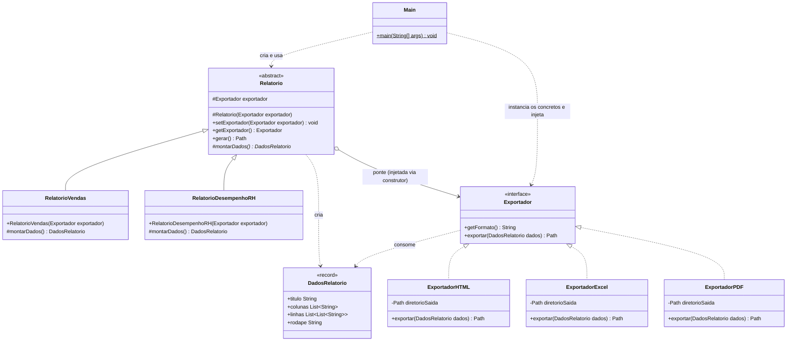
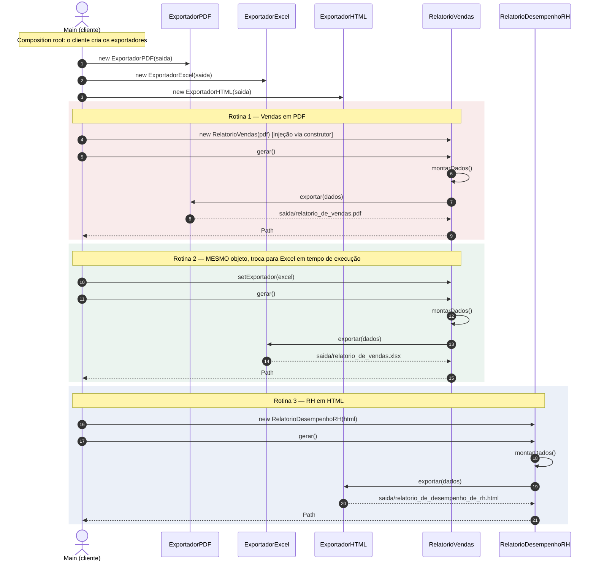

# TechFatec BI — Módulo de Relatórios com Padrão Bridge

Atividade de Padrões de Projeto — **2º semestre ADS AMS (noite)**

| Integrantes |
|---|
| Gustavo Mendes Ventieri Mariano |
| Tiago Bryan Ramos de Oliveira |

🎥 **Vídeo de defesa técnica:** _link do YouTube aqui_

---

## 1. O problema

O sistema legado de inteligência de negócios da TechFatec gerava **apenas** o *Relatório de Vendas* em **PDF**.
O novo requisito pede:

- um novo relatório: **Relatório de Desempenho de RH**;
- que **todos** os relatórios (atuais e futuros) sejam exportáveis em **PDF, Excel (XLSX) e HTML**.

### Por que não resolver só com herança?

Se cada combinação "relatório + formato" virar uma subclasse, o número de classes **multiplica**:

```
Relatorio
├── RelatorioVendasPDF      ├── RelatorioRHPDF
├── RelatorioVendasExcel    ├── RelatorioRHExcel
└── RelatorioVendasHTML     └── RelatorioRHHTML
```

| | 2 relatórios × 3 formatos | 5 relatórios × 5 formatos |
|---|---|---|
| Só herança (R × F) | 6 subclasses | **25** subclasses |
| Bridge (R + F) | 5 classes | **10** classes |

Isso é a **explosão de subclasses**. Além disso, adicionar um formato obrigaria a mexer em todas as famílias de relatório, violando o **Princípio Aberto/Fechado (OCP)**.

## 2. A solução: Padrão Bridge

> *Bridge* (GoF): desacopla uma abstração da sua implementação, de modo que as duas possam variar independentemente.

Separamos o sistema em **duas hierarquias independentes**, ligadas por **composição** (a "ponte"):

| Papel no Bridge | Classe | Responsabilidade |
|---|---|---|
| **Abstraction** | `abstracao.Relatorio` | Fluxo de geração; guarda a referência ao `Exportador` (a ponte) |
| **Refined Abstraction** | `abstracao.RelatorioVendas`, `abstracao.RelatorioDesempenhoRH` | **O QUE** cada relatório contém |
| **Implementor** | `implementacao.Exportador` (interface) | Contrato de exportação |
| **Concrete Implementor** | `implementacao.ExportadorPDF`, `ExportadorExcel`, `ExportadorHTML` | **COMO** gravar em cada formato |
| DTO da ponte | `implementacao.DadosRelatorio` | Conteúdo neutro (título, colunas, linhas, rodapé) |
| **Client** | `cliente.Main` | Cria os exportadores e os **injeta** nos relatórios |

## 3. Estrutura de diretórios

```
techfatec-bridge/
├── src/
│   ├── abstracao/                 ← lado "O QUE" (relatórios)
│   │   ├── Relatorio.java
│   │   ├── RelatorioVendas.java
│   │   └── RelatorioDesempenhoRH.java
│   ├── implementacao/             ← lado "COMO" (formatos)
│   │   ├── Exportador.java
│   │   ├── DadosRelatorio.java
│   │   ├── ExportadorPDF.java
│   │   ├── ExportadorExcel.java
│   │   └── ExportadorHTML.java
│   └── cliente/                   ← script de validação
│       └── Main.java
├── docs/                          ← diagramas em imagem (PNG)
├── executar.bat                   ← compila e executa (Windows)
├── executar.sh                    ← compila e executa (Linux/macOS)
└── README.md
```

## 4. Diagrama de classes



> Versão em imagem: [docs/diagrama-classes.png](docs/diagrama-classes.png)

Leitura do diagrama:

- De um lado, a hierarquia da **abstração** (relatórios); do outro, a hierarquia da **implementação** (formatos).
- A única ligação entre elas é a **agregação** `Relatorio o--> Exportador` — a ponte. Ela aponta para a **interface**, nunca para uma classe concreta (**Princípio da Inversão de Dependência**).
- Somente o `Main` (cliente) conhece as classes concretas.

## 5. Diagrama de sequência (script de validação)



> Versão em imagem: [docs/diagrama-sequencia.png](docs/diagrama-sequencia.png)

## 6. Injeção de dependência

É **proibido** usar `new` de um exportador concreto dentro das classes de relatório. A dependência chega **pelo construtor**:

```java
// abstracao/Relatorio.java
protected Relatorio(Exportador exportador) {
    this.exportador = Objects.requireNonNull(exportador);
}
```

Quem decide qual formato usar é o **cliente** (`cliente/Main.java`), o único lugar com `new ExportadorXxx(...)`:

```java
Exportador pdf   = new ExportadorPDF(saida);
Exportador excel = new ExportadorExcel(saida);
Exportador html  = new ExportadorHTML(saida);

Relatorio vendas = new RelatorioVendas(pdf);   // 1. Vendas em PDF
vendas.gerar();

vendas.setExportador(excel);                   // 2. mesmo objeto, agora Excel
vendas.gerar();

Relatorio rh = new RelatorioDesempenhoRH(html); // 3. RH em HTML
rh.gerar();
```

Pode ser conferido com uma busca: o único arquivo que contém `new Exportador` é o `Main.java`.

```bash
grep -rn "new Exportador" src/
```

## 7. Princípios SOLID atendidos

| Princípio | Como aparece no projeto |
|---|---|
| **S** — Responsabilidade Única | Relatório cuida do **conteúdo**; exportador cuida do **formato**. |
| **O** — Aberto/Fechado | Novo formato (ex.: CSV) = **nova classe** que implementa `Exportador`. Novo relatório (ex.: Financeiro) = **nova classe** que estende `Relatorio`. Nenhum código existente é alterado. |
| **L** — Substituição de Liskov | Qualquer `Exportador` pode substituir outro em `setExportador(...)` sem quebrar o relatório. |
| **D** — Inversão de Dependência | `Relatorio` depende da **interface** `Exportador`, não de `ExportadorPDF`. |

**Exemplo de extensão (OCP):** para suportar CSV, basta criar:

```java
public class ExportadorCSV implements Exportador {
    public String getFormato() { return "CSV"; }
    public Path exportar(DadosRelatorio dados) { /* grava .csv */ }
}
```

…e injetá-lo: `new RelatorioVendas(new ExportadorCSV(saida))`. Nenhuma linha de `Relatorio`, `RelatorioVendas` ou `RelatorioDesempenhoRH` muda.

## 8. Como executar

Pré-requisito: **JDK 17 ou superior** (testado com JDK 21). Não há dependências externas — PDF e XLSX são gerados apenas com a biblioteca padrão do Java.

**Windows**

```bat
executar.bat
```

**Linux / macOS / Git Bash**

```bash
sh executar.sh
```

**Manualmente**

```bash
javac -encoding UTF-8 -d out src/abstracao/*.java src/implementacao/*.java src/cliente/*.java
java -cp out cliente.Main
```

### Saída esperada

```
==============================================
 TechFatec BI - Módulo de Relatórios (Bridge)
==============================================

[1] Relatório de Vendas em PDF
  -> RelatorioVendas monta os dados e delega para ExportadorPDF
  OK: PDF gerado em saida\relatorio_de_vendas.pdf

[2] Mesmo relatório de vendas, trocado para Excel em tempo de execução
  -> Objeto antes da troca:  RelatorioVendas@1a86f2f1
  -> Objeto após a troca:    RelatorioVendas@1a86f2f1
  -> RelatorioVendas monta os dados e delega para ExportadorExcel
  OK: Excel (XLSX) gerado em saida\relatorio_de_vendas.xlsx

[3] Relatório de Desempenho de RH em HTML
  -> RelatorioDesempenhoRH monta os dados e delega para ExportadorHTML
  OK: HTML gerado em saida\relatorio_de_desempenho_de_rh.html

==============================================
 3 rotinas executadas com sucesso.
 Herança pura: 2 relatórios x 3 formatos = 6 subclasses.
 Com Bridge:   2 relatórios + 3 formatos = 5 classes.
==============================================
```

O mesmo *hash* de objeto antes e depois da troca comprova que **não foi criado um novo relatório**: apenas o exportador foi trocado em tempo de execução.

Os arquivos reais são gravados na pasta `saida/` e podem ser abertos no leitor de PDF, no Excel e no navegador.
